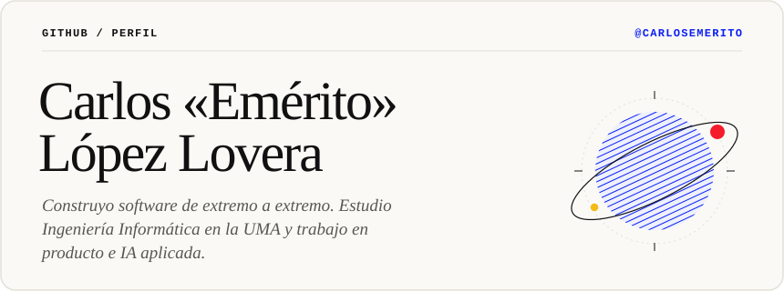
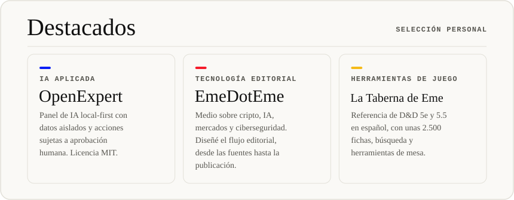
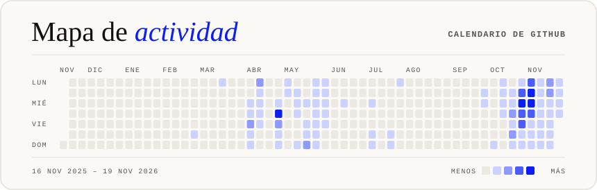
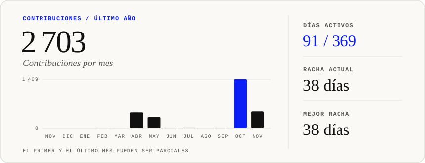

[Portfolio](https://carloslopezlovera.es) · [LinkedIn](https://www.linkedin.com/in/carlos-lopez-lovera-3115182a6/) · [Email](mailto:carlosemerito13@gmail.com) · [Sobre mí / About me](./SOBRE-MI.md)

[OpenExpert](https://github.com/OpenExpert-ai/OpenExpert) · [EmeDotEme](https://www.emedoteme.es) · [La Taberna de Eme](https://carlosemerito.github.io/latabernadeeme/) · [Dotfiles de Arch Linux y Hyprland](https://github.com/CarlosEmerito/dotfiles)

